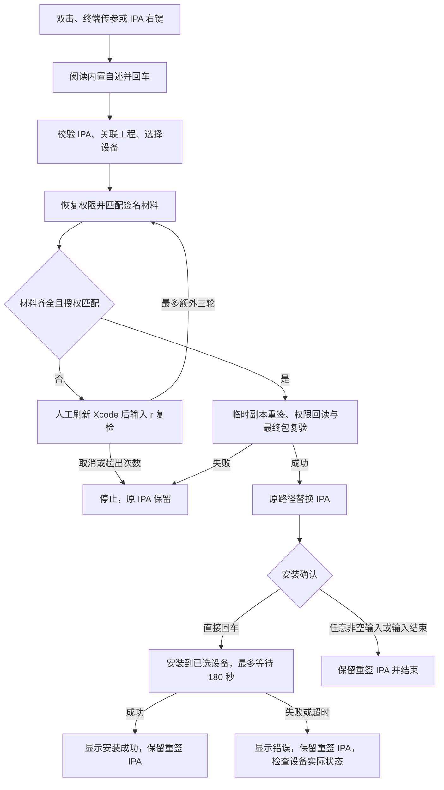

# IPA 免编译重签与设备安装


<!-- jobs-toc:start -->
<!-- jobs-toc:source {"v":2,"token":"[toc]"} -->
<details>
<summary>📚 目录（点击展开 / 收起）</summary>

- [🔥 前言](#jobs-toc-heading-1)
- [一、功能总览](#feature-overview)
- [二、适用范围与准备条件](#requirements)
- [三、运行方式](#run-methods)
  - [3.1、双击运行](#double-click)
  - [3.2、终端运行](#terminal-run)
  - [3.3、Finder 右键运行](#finder-menu)
- [四、完整操作流程](#operation-flow)
  - [4.1、输入 IPA 与关联工程](#input-and-project)
  - [4.2、选择设备](#device-selection)
  - [4.3、恢复权限与匹配签名材料](#signing-materials)
  - [4.4、材料不足时刷新 Xcode](#xcode-refresh)
  - [4.5、重签、覆盖与安装](#resign-and-install)
- [五、产物、日志与失败边界](#outputs-and-failures)
- [六、验证方式与现有验证范围](#validation)
- [七、常见问题](#faq)

</details>
<!-- jobs-toc:end -->

---

## <span id="jobs-toc-heading-1" data-jobs-toc="v2">🔥 <font id=前言>前言</font></span><!-- jobs-toc:heading-end -->

对已有、未加密的 [**iOS**](https://developer.apple.com/ios/) IPA 重新签名，保留原团队与 Bundle ID，不重新编译源码。脚本使用 [**Xcode**](https://developer.apple.com/xcode) 工具链和系统原生命令，分别处理主 App、扩展及嵌套动态代码；验证成功后替换原 IPA，再按确认结果直接安装到设备，无需额外的设备安装工具。

入口：[【MacOS】✍️IPA免编译重签.command](./【MacOS】✍️IPA免编译重签.command)。

右键入口：[IPA 免编译重签 Finder 扩展](../../../OS@Extension/MacOS@Extension/JobsIPAResigner/README.md)，独立安装后仅对单个 `.ipa` 普通文件显示；点击后将所选文件传入交互式终端。

<span style="color:red"><b>重签成功会覆盖原 IPA，不自动保留旧版本。需要留存旧包时，运行前自行复制备份。</b></span>

## 一、<span id="feature-overview">功能总览</span> <a href="#前言" style="font-size:17px; color:green;"><b>🔼</b></a> <a href="#🔚" style="font-size:17px; color:green;"><b>🔽</b></a>

| 功能 | 当前能力与操作颗粒度 | 详细说明 |
| --- | --- | --- |
| 运行入口 | 双击、终端传参、Finder 单个 IPA 右键；均先显示自述并确认 | [运行方式](#run-methods) |
| 工程关联 | 回车从 IPA 向上查找；也可拖入目录，按主 App Bundle ID 验证 | [输入与工程](#input-and-project) |
| 设备选择 | 单台自动选中，多台 fzf 单选，无设备可重扫或手填；支持指定 UDID | [选择设备](#device-selection) |
| 权限恢复 | 优先已有签名权限，其次解析工程；不能唯一确定时手动提供文件 | [权限与材料](#signing-materials) |
| 材料匹配 | 主 App 与扩展逐项核对授权，共用签名身份，各取最晚到期的可用描述文件 | [权限与材料](#signing-materials) |
| 材料复检 | 提示人工打开 Xcode 刷新，首次检查后最多额外复检三轮 | [Xcode 复检](#xcode-refresh) |
| 重签与交付 | 临时副本中签名，回读权限并复验最终包，成功后原路径替换 | [重签与安装](#resign-and-install) |
| 可选安装 | 替换完成后回车安装，任意非空输入结束；不自动卸载或启动 App | [重签与安装](#resign-and-install) |
| 日志与清理 | 纯文本日志留在系统临时目录，中间文件正常退出时清理 | [产物与失败边界](#outputs-and-failures) |

## 二、<span id="requirements">适用范围与准备条件</span> <a href="#前言" style="font-size:17px; color:green;"><b>🔼</b></a> <a href="#🔚" style="font-size:17px; color:green;"><b>🔽</b></a>

| 项目 | 要求或行为 |
| --- | --- |
| 系统 | [**macOS**](https://www.apple.com/macos/)，使用系统 [**zsh**](https://www.zsh.org/)，在可交互终端运行 |
| 工具链 | 安装并配置 Xcode，`xcrun` 能找到 `otool`、`devicectl` |
| 输入 | 自有、未加密的 iOS Development / Ad Hoc IPA，`Payload` 下只有一个主 App |
| 工程 | 提供对应工程目录，或从 IPA 位置向上自动定位；按主 App 的 Bundle ID 验证归属 |
| 签名 | 有效描述文件、匹配的签名证书及钥匙串私钥；目标设备 UDID 已被授权 |
| 扩展 | 每个扩展都必须有匹配的描述文件和权限；全部 bundle 必须能由同一可用签名身份签署 |
| 多设备 | 使用 [**fzf**](https://formulae.brew.sh/formula/fzf) 单选；仅检测到一台可用设备时自动选中 |
| 安装 | 手机已连接、解锁并信任 Mac；开发签名在适用系统上需要开启开发者模式 |

不支持 App Store 加密包、跨团队迁移、Watch App、macOS / tvOS 包和嵌套 XPC 服务。脚本不修改 Bundle ID，不自动登录 Apple、不申请证书、不续期描述文件，也不调用源码构建。

最终 IPA 只重新封装 `Payload/`，原 ZIP 根目录的 `SwiftSupport/`、`Symbols/`、`iTunesMetadata.plist` 等其它成员不会保留；该入口面向开发 / Ad Hoc 设备安装，不作为商店上传包的保真转换工具。

免费 Personal Team 的描述文件自签发起 7 天过期；保存或重新压缩 IPA 不会延长有效期。需要先取得有效的新描述文件，再重签。参见 [Apple 免费账号限制](https://developer.apple.com/support/compare-memberships/)。

## 三、<span id="run-methods">运行方式</span> <a href="#前言" style="font-size:17px; color:green;"><b>🔼</b></a> <a href="#🔚" style="font-size:17px; color:green;"><b>🔽</b></a>

### 3.1、<span id="double-click">双击运行</span> <a href="#前言" style="font-size:17px; color:green;"><b>🔼</b></a> <a href="#🔚" style="font-size:17px; color:green;"><b>🔽</b></a>

双击同目录的 `.command`，阅读内置自述后回车。依次提供 IPA、关联工程并选择目标设备。

文件路径支持手动输入、[**Finder**](https://support.apple.com/guide/mac-help/welcome/mac) 拖入、中文、空格和常规引号／转义写法。每次只接受一个文件，不支持批量拖入多个 IPA。

### 3.2、<span id="terminal-run">终端运行</span> <a href="#前言" style="font-size:17px; color:green;"><b>🔼</b></a> <a href="#🔚" style="font-size:17px; color:green;"><b>🔽</b></a>

在本目录打开终端：

```shell
/bin/zsh './【MacOS】✍️IPA免编译重签.command'
```

可提前指定 IPA，或同时指定目标 UDID。下列路径与 UDID 为占位示例，需要替换为实际值：

```shell
/bin/zsh './【MacOS】✍️IPA免编译重签.command' \
  './待处理/App.ipa'

/bin/zsh './【MacOS】✍️IPA免编译重签.command' \
  './待处理/App.ipa' \
  '目标设备UDID'
```

| 参数 | 省略时的行为 |
| --- | --- |
| 第一个参数：IPA 路径 | 提示输入或拖入，空输入持续等待 |
| 第二个参数：设备 UDID | 自动扫描设备，单台自动选择，多台用 fzf |

指定参数后仍有运行确认、工程关联和安装确认，不能作为无交互批处理使用。第二个参数必须是硬件 UDID，不是序列号、IMEI 或 `devicectl` 的内部 UUID。

### 3.3、<span id="finder-menu">Finder 右键运行</span> <a href="#前言" style="font-size:17px; color:green;"><b>🔼</b></a> <a href="#🔚" style="font-size:17px; color:green;"><b>🔽</b></a>

1、按[独立扩展说明](../../../OS@Extension/MacOS@Extension/JobsIPAResigner/README.md)安装并启用 `JobsIPAResigner`；总安装面板也可单独勾选此功能。

2、在 Finder 只选中一个普通 `.ipa` 文件，右键选择“IPA 免编译重签”。后缀大小写均可；其它后缀、文件夹、符号链接、多选和空白位置不显示。

3、[**Terminal**](https://support.apple.com/guide/terminal/welcome/mac) 打开后先阅读自述并回车；所选 IPA 自动传入，随后关联工程、选择设备并重签。点击菜单本身不会直接替换文件或安装设备。

扩展内携带完整重签脚本，可独立运行；菜单所选文件还会在执行前再次校验。描述文件优先使用用户已有的 Xcode 缓存；扩展的补充材料位置与日志见[脚本目录说明](../../../OS@Extension/MacOS@Extension/JobsIPAResigner/Scripts/README.md)。

## 四、<span id="operation-flow">完整操作流程</span> <a href="#前言" style="font-size:17px; color:green;"><b>🔼</b></a> <a href="#🔚" style="font-size:17px; color:green;"><b>🔽</b></a>

以下 [**Mermaid**](https://mermaid.js.org) 流程包含文件替换与安装的不同失败边界：



### 4.1、<span id="input-and-project">输入 IPA 与关联工程</span> <a href="#前言" style="font-size:17px; color:green;"><b>🔼</b></a> <a href="#🔚" style="font-size:17px; color:green;"><b>🔽</b></a>

1、阅读说明并回车；拖入 IPA 后回车。空输入、只输入空白或路径不存在时继续提示。输入 `q` 退出。

2、在工程目录提示处直接回车，从 IPA 所在目录逐层向上查找每层直接包含的 `.xcodeproj`。在 [**Git**](https://git-scm.com/) 仓库内以仓库根目录为上界；不在仓库内时向上查到文件系统根目录。

3、脚本读取 `project.pbxproj`，验证存在 iOS 应用 Target，且 Bundle ID 与 IPA 主 App 匹配。唯一匹配后使用仓库根目录，或 `.xcodeproj` 所在目录，作为对应工程目录。

4、自动查找失败时红字提示，手动拖入对应工程文件夹。再次回车会重新自动查找，不退出。手动目录会递归查找工程，跳过 `.git`、`Pods`、`node_modules`、`build`、`DerivedData`、`.dart_tool`。

自动向上查找不会横向遍历所有子目录。IPA 被移到下载目录，或工程位于祖先目录的其它子目录中时，使用手动拖入。

<span style="color:red"><b>工程配置采用静态解析，不是完整的 Xcode Build Settings 求值器。</b></span> 如果 Bundle ID 或平台设置依赖无法展开的 `.xcconfig`，工程归属校验可能失败；仅换一个目录不能保证解决。目前流程要求工程通过归属校验，没有“跳过工程”或独立“只安装”模式。

### 4.2、<span id="device-selection">选择设备</span> <a href="#前言" style="font-size:17px; color:green;"><b>🔼</b></a> <a href="#🔚" style="font-size:17px; color:green;"><b>🔽</b></a>

- 只有一台可用的真实 iPhone / iPad：自动获取硬件 UDID，并高亮显示名称、型号与连接方式。
- 存在多台：进入 fzf，输入关键词过滤、方向键选择、回车确认；`Esc` 取消并结束，不默认替代为第一台。
- 未检测到设备：连接、解锁并信任电脑后输入 `r` 重扫；回车或 `m` 改为手动输入 UDID；`q` 退出。
- 显式传入第二个参数：直接使用指定 UDID，跳过设备选择。安装沿用同一个 UDID，不重复选择。

只有进入多设备选择时才检查 fzf。按当前 PATH、Apple Silicon 与 Intel 的 Homebrew 常见位置查找，并运行版本检查。缺失或损坏时，找到可用 [**Homebrew**](https://brew.sh/) 后提示安装／重装：**回车跳过并退出，输入任意字符才执行**。安装后复检，失败即停止；没有可用 Homebrew 时提示人工处理，不自动安装 Homebrew。

### 4.3、<span id="signing-materials">恢复权限与匹配签名材料</span> <a href="#前言" style="font-size:17px; color:green;"><b>🔼</b></a> <a href="#🔚" style="font-size:17px; color:green;"><b>🔽</b></a>

优先保留 IPA 中已有的签名权限。权限缺失时，按 Bundle ID 查找对应 Target 的 `CODE_SIGN_ENTITLEMENTS`；仅在目标唯一、各配置可解析且指向同一文件时自动读取。条件覆盖、未解析变量或多候选等情况转为手动提供 `.entitlements` / `.xcent`。

在 Xcode 的对应 Target → Build Settings 中搜索 `Code Signing Entitlements` 可定位权限文件。主 App 和扩展各用自己的文件，不能把主 App 的权限无条件套给全部扩展。

原始描述文件缺失时，脚本会要求提供该 Target 的原始 `.mobileprovision`；允许使用过期文件确认原团队与 App ID 前缀，但它不能代替有效的新签名材料。

有效描述文件搜索范围：

- 当前用户 Xcode UserData 中的 `Provisioning Profiles` 缓存。
- 当前用户旧版 MobileDevice 中的 `Provisioning Profiles` 缓存。
- 本脚本同目录的可选 `./描述文件/` 目录。

```text
当前目录/
├── 【MacOS】✍️IPA免编译重签.command
├── README.md
└── 描述文件/                         # 可选，手动放入描述文件
    ├── 主App.mobileprovision
    └── 扩展.mobileprovision
```

逐项核对团队、App ID 前缀、Bundle ID、有效期、设备授权、证书私钥和权限。先找到能覆盖全部 App／扩展的共同签名身份，再在该身份对应的候选中选择每个 bundle 最晚到期的描述文件。

### 4.4、<span id="xcode-refresh">材料不足时刷新 Xcode</span> <a href="#前言" style="font-size:17px; color:green;"><b>🔼</b></a> <a href="#🔚" style="font-size:17px; color:green;"><b>🔽</b></a>

1、脚本打印失败原因。未检测到 Xcode 运行时暂停：输入 `o` 尝试打开；手动打开后回车复检；`q` 退出。

2、打开对应工程，在 Settings → Accounts 配置原团队账号；为主 App 和每个扩展检查 Signing & Capabilities。免费账号使用 Personal Team 与自动签名，确认目标设备已授权。

3、等待签名刷新，必要时执行 Try Again 或 Run。脚本本身不会编译，但人工使用 Run 可能触发增量构建。

4、返回终端，输入 `r` 重新收集证书和描述文件；直接回车或输入其它内容结束。首次检查后最多额外复检三轮。

**Xcode 已打开不等于描述文件已续期。** 本机材料已经齐全时，不强制打开 Xcode。

### 4.5、<span id="resign-and-install">重签、覆盖与安装</span> <a href="#前言" style="font-size:17px; color:green;"><b>🔼</b></a> <a href="#🔚" style="font-size:17px; color:green;"><b>🔽</b></a>

1、在临时副本中从内到外签署动态代码，再分别签署扩展和主 App。

2、每个 Target 单独回读权限并与计划值比较；完成深度签名校验后压缩，再解包复验。

3、在原 IPA 同目录暂存新包，比较复制内容一致后原子替换原文件。**文件名与路径保持不变，不另存桌面结果目录。**

4、显示安装目标并等待确认：<span style="color:red"><b>直接回车安装；输入任意字符，包括空格，结束脚本。</b></span> 跳过安装不撤销已经完成的 IPA 替换。

安装使用最终 IPA 解包得到的 `.app`，执行 `xcrun devicectl device install app`，超时为 180 秒。命令和结构化结果均成功后才显示安装成功。不会自动启动 App，也不会自动卸载设备上的旧 App。

## 五、<span id="outputs-and-failures">产物、日志与失败边界</span> <a href="#前言" style="font-size:17px; color:green;"><b>🔼</b></a> <a href="#🔚" style="font-size:17px; color:green;"><b>🔽</b></a>

| 阶段或产物 | 行为 |
| --- | --- |
| 校验和替换完成之前失败 | 原 IPA 保留 |
| 替换成功 | 原路径已经是重签后的 IPA，旧版本不自动备份 |
| 跳过安装 | 保留重签 IPA，结束脚本 |
| 安装失败或超时 | 保留重签 IPA，显示工具错误；不会退回旧签名，也不自动卸载旧 App |
| 桌面附件 | 不生成额外 IPA、报告、哈希或日志附件 |
| 排查日志 | 系统临时目录中的 `IPA免编译重签.时间戳.进程号.log`，结束时显示实际位置 |
| 中间产物 | 解包副本、权限文件、检查报告和安装 JSON 位于临时工作目录，正常退出时清理 |

运行时自述标题红色加粗、正文蓝色常规字重；业务标题加粗，设备信息使用青色，成功／警告／错误分别使用绿／黄／红色。日志保持纯文本。设置 `NO_COLOR`、输出重定向或终端类型为 `dumb` 时关闭脚本颜色；外部工具输出可能保持自己的格式。

强制终止进程或系统中断可能留下临时目录。安装超时不等于设备绝对没有完成安装，应检查设备实际状态后再决定是否重试。

## 六、<span id="validation">验证方式与现有验证范围</span> <a href="#前言" style="font-size:17px; color:green;"><b>🔼</b></a> <a href="#🔚" style="font-size:17px; color:green;"><b>🔽</b></a>

仅检查脚本语法，不触发重签或安装：

```shell
/bin/zsh -n './【MacOS】✍️IPA免编译重签.command'
```

当前脚本的空输入循环、路径解析、工程定位、权限匹配、多设备 fzf 选择及安装确认分支已有模拟验证；真实 IPA 重签、权限回读、最终解包签名校验和原路径替换已有验收记录。

设备安装流程的回车确认与字符取消已通过模拟测试，尚无本工具真实手机安装成功的验收记录。不同工程结构、Xcode 版本和设备状态仍需按实际安装结果确认。

Finder 扩展的菜单过滤、路径传递、安装映射、临时 Debug 构建与打包脚本字节校验已通过；临时系统登记已清理，未安装启用扩展、刷新 Finder 或执行真实重签。右键和 Terminal 的实际交互需在安装后验收，详见[扩展验证说明](../../../OS@Extension/MacOS@Extension/JobsIPAResigner/README.md#diagnostics)。

## 七、<span id="faq">常见问题</span> <a href="#前言" style="font-size:17px; color:green;"><b>🔼</b></a> <a href="#🔚" style="font-size:17px; color:green;"><b>🔽</b></a>

**为什么不需要每次编译，却仍需更新描述文件？**

编译生成程序二进制，签名与描述文件决定安装授权。代码不变时可复用二进制；描述文件过期后仍须获取有效材料并重签。

**为什么自动找到工程后，还可能要求权限文件？**

工程归属验证与权限路径解析是两个检查。Target 唯一不代表所有配置的 `CODE_SIGN_ENTITLEMENTS` 都能静态解析。提供该 Target 的准确权限文件或生成的 `.xcent`，不要随意删除无法授权的权限。

**只有描述文件，没有证书私钥，能否重签？**

不能。钥匙串必须存在描述文件允许的有效签名身份和对应私钥；只有证书文件或 `.mobileprovision` 不够。

**当前 IPA 本来就有效，能否跳过重签直接安装？**

当前入口固定执行“关联工程 → 重签 → 替换 → 可选安装”，没有独立的只安装入口。

**安装失败后是否应先卸载旧 App？**

先看工具输出，检查连接、信任、开发者模式、系统兼容性、签名和设备授权。卸载可能丢失数据，不作为脚本自动修复步骤。

**为什么仍有临时日志？**

日志用于定位签名、权限及设备安装错误，仅保留在系统临时目录；交付结果只有原路径下被替换的 IPA，不产生额外桌面附件。

<a id="🔚" href="#前言" style="font-size:17px; color:green; font-weight:bold;">我是有底线的➤点我回到首页</a>
