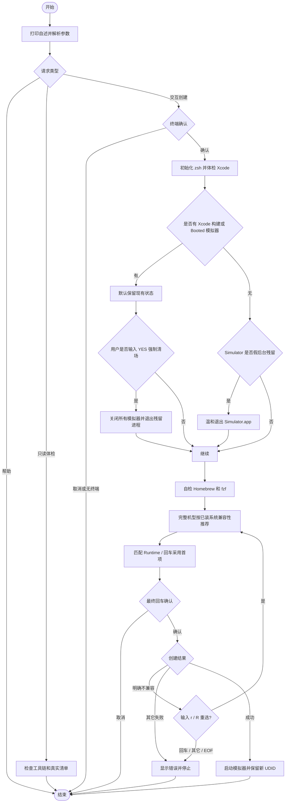

# `【MacOS】📱双击初始化iOS模拟器.command`


<!-- jobs-toc:start -->
<!-- jobs-toc:source {"v":2,"token":"[toc]"} -->
<details>
<summary>📚 目录（点击展开 / 收起）</summary>

- [🔥 前言](#jobs-toc-heading-1)
- [一、适用场景](#jobs-toc-heading-2)
- [二、脚本信息](#jobs-toc-heading-3)
- [三、运行方式](#jobs-toc-heading-4)
- [四、执行流程](#jobs-toc-heading-5)
- [五、交互规则](#jobs-toc-heading-6)
- [六、执行前检查](#jobs-toc-heading-7)
- [七、流程图](#jobs-toc-heading-8)
- [八、常见问题](#jobs-toc-heading-9)
- [九、风险边界](#jobs-toc-heading-10)

</details>
<!-- jobs-toc:end -->

---

## <span id="jobs-toc-heading-1" data-jobs-toc="v2">🔥 <font id=前言>前言</font></span><!-- jobs-toc:heading-end -->

> 这是一份双击脚本外部 README，面向运行前阅读；脚本运行后还会打印内置自述并等待确认，README 不替代脚本自身的防误触提示。

- 本脚本用于在 [**macOS**](https://www.apple.com/macos/) 上先选择完整 iPhone / iPad 型号，再选择已安装 iOS Runtime，创建并启动一个新的 iOS 模拟器。
- 脚本依赖 [**Xcode**](https://developer.apple.com/xcode) / `xcrun simctl` 提供的模拟器环境，并使用 [**fzf**](https://formulae.brew.sh/formula/fzf) 完成交互选择。
- 脚本会自检 [**Homebrew**](https://brew.sh/) 和 `fzf`。如果未安装会尝试安装；如果已安装，更新 / 升级类动作默认回车跳过，输入任意字符后回车才执行。
- 脚本默认不会无差别关闭正在使用的模拟器。只有用户明确输入 `YES`，才会执行 `shutdown all` / `quit` / `pkill` 这类强制清场动作。

| 入口 | 实际行为 |
| --- | --- |
| 双击或无参数运行 | 自述确认 → 原有清场与依赖自检 → 完整机型 → 可用系统 → 最终回车创建并启动 |
| `--help` / `-h` | 显示帮助，不探测工具链、不写日志、不清场或安装 |
| `--check` | 只读检查当前 Xcode、模拟器界面、完整机型、可搭配 / 无可搭配机型数量、每个可用系统支持的机型数及回车首选组合，不创建或启动设备 |
| 桌面右键“新建 iOS 模拟器” | 嵌入同一核心，保留原有设备与调试会话，跳过本入口的清场及依赖安装 |

本文件是[右键模拟器功能](../../../OS@Extension/MacOS@Extension/JobsIOSSimulatorCreator/README.md)的核心规范源。两个入口保留可独立复制运行的完整脚本；`# >>> Jobs iOS simulator core >>>` 与结束标记之间的状态和函数逐字节一致，自述和前置编排在标记外。修改核心后同步右键副本，并运行两侧相同的隔离测试和字节一致性检查；运行时不依赖另一脚本或公共库。

## <span id="jobs-toc-heading-2" data-jobs-toc="v2">一、适用场景 <a href="#前言" style="font-size:17px; color:green;"><b>🔼</b></a> <a href="#🔚" style="font-size:17px; color:green;"><b>🔽</b></a></span><!-- jobs-toc:heading-end -->

- 需要快速创建一个指定 iPhone / iPad 型号 + 指定 iOS 版本组合的新模拟器。
- 需要避免手动打开 `Devices and Simulators` 后逐项选择设备类型和 Runtime。
- 需要在 iOS 调试前准备一个干净、命名清楚的新模拟器。
- 需要温和处理没有 Booted 设备但 `Simulator.app` 仍残留的假后台状态。

## <span id="jobs-toc-heading-3" data-jobs-toc="v2">二、脚本信息 <a href="#前言" style="font-size:17px; color:green;"><b>🔼</b></a> <a href="#🔚" style="font-size:17px; color:green;"><b>🔽</b></a></span><!-- jobs-toc:heading-end -->

| 项目 | 说明 |
| --- | --- |
| 脚本名称 | `【MacOS】📱双击初始化iOS模拟器.command` |
| 所属目录 | `JobsGenesis/JobsCommand@iOS/其他` |
| 主要用途 | 创建并启动新的 iOS 模拟器 |
| 依赖工具 | `xcrun simctl`、`open`、`osascript`、`fzf`、`brew` |
| 是否可能联网 | 是。首次安装 Homebrew / fzf 或选择升级时会联网 |
| 是否可能修改环境 | 是。首次安装 Homebrew 时可能写入 shell 配置文件 |
| 是否含高风险操作 | 是。强制关闭模拟器必须输入 `YES` |
| 日志位置 | 系统临时目录中的 `【MacOS】📱双击初始化iOS模拟器.<进程编号>.log`，确认后创建；只读入口不写日志 |

## <span id="jobs-toc-heading-4" data-jobs-toc="v2">三、运行方式 <a href="#前言" style="font-size:17px; color:green;"><b>🔼</b></a> <a href="#🔚" style="font-size:17px; color:green;"><b>🔽</b></a></span><!-- jobs-toc:heading-end -->

- 推荐方式：双击 `【MacOS】📱双击初始化iOS模拟器.command`。
- 终端方式：

  ```shell
  cd '.'
  chmod +x './【MacOS】📱双击初始化iOS模拟器.command'
  './【MacOS】📱双击初始化iOS模拟器.command'
  ```

- 脚本启动后会先打印内置自述，并等待回车确认。确认前不会进入模拟器清理、依赖安装或模拟器创建流程。
- 取消方式：在确认前或交互选择阶段按 `Ctrl+C` 终止。

- 只读体检（不清场或安装依赖）：

  ```shell
  /bin/zsh './【MacOS】📱双击初始化iOS模拟器.command' --check
  ```

## <span id="jobs-toc-heading-5" data-jobs-toc="v2">四、执行流程 <a href="#前言" style="font-size:17px; color:green;"><b>🔼</b></a> <a href="#🔚" style="font-size:17px; color:green;"><b>🔽</b></a></span><!-- jobs-toc:heading-end -->

1、打印脚本内置自述，说明用途、影响范围、日志位置和取消方式。帮助与只读体检先分流，不进入后续清场和安装。

2、交互入口确认后初始化 zsh，兼容路径里的中文、空格和特殊符号，并体检当前 Xcode / simctl 和同一 Xcode 的模拟器界面。

3、检查 `Xcode` / `xcodebuild` / `XCBBuildService` / Booted 模拟器状态。

4、按风险分级处理 `Simulator.app`：

  | 当前状态 | 默认策略 |
  | --- | --- |
  | 检测到 Xcode 构建进程 | 跳过清理，避免中断编译 |
  | 检测到 Booted 模拟器 | 保留现有模拟器 |
  | 无 Booted 设备但 Simulator 仍运行 | 温和退出 `Simulator.app` |
  | 用户输入 `YES` 强制清场 | 执行 `xcrun simctl shutdown all`，退出并必要时 `pkill` |

5、自检 [**Homebrew**](https://brew.sh/)：未安装则安装；已安装时询问是否更新。

6、自检 [**fzf**](https://formulae.brew.sh/formula/fzf)：未安装则安装；已安装时询问是否升级。

7、从完整 `devicetypes` 清单选择 iPhone / iPad 型号，不隐藏传统型号；有确认支持的已装系统的型号优先，其次为兼容信息未知，最后是没有可搭配系统的型号，组内保留原顺序。本机没有任何已装系统可搭配的型号在列表中带“（本机无可搭配系统）”标注，选择前即可识别，标注不会进入设备名。回车采用第 1 项。

8、按选定型号匹配可用 iOS Runtime，排除明确不兼容项并按展示名和标识去重，并先打印“本机已装 N 个 iOS 系统，其中 M 个匹配该型号”；确认支持的系统优先、组内最新优先，回车采用第 1 项。未被 Xcode 明确列为支持的系统带“（未确认支持）”标注，最终确认前再次提示风险。有效 Runtime 支持名单优先于通用版本范围；元数据缺失或不完整时，只用有效上下限排除明确越界项，其余保留为未知。健康 `fzf` 优先；没有健康选择器时使用同样支持回车首项的编号列表。没有可搭配系统时说明原因并停止，输入 `r` / `R` 可直接回到机型选择，不尝试已知不兼容组合。

9、展示型号、系统与唯一名称，回车才执行 `simctl create`；非空输入或 EOF 取消。名称格式为 `型号名@年.月.日 时:分:秒-进程号`，例如 `iPhone 18 Pro@2026.10.21 11:31:49-35685`；时间取创建时刻，进程号为脚本进程，同秒重复创建也不会撞名。创建前刷新 `xcrun simctl list devices --json`，与既有设备重名时依次追加 ` (2)`、` (3)`。型号列表里的"（本机无可搭配系统）"与系统列表里的"（未确认支持）"标注只用于选择，不进入设备名。该命名是[右键模拟器功能](../../../OS@Extension/MacOS@Extension/JobsIOSSimulatorCreator/README.md)与 [Flutter 项目右键运行](../../../OS@Extension/MacOS@Extension/JobsFlutterRunner/README.md)内置初始化的共用约定，三处保持一致。

10、创建成功后执行 `boot`，打开同一 Xcode 的 `Simulator.app` 或 Device Hub，并通过 `bootstatus` 确认启动；启动失败保留新设备与 UDID。

11、正常创建只选择一轮型号和系统。只有明确返回 `Incompatible device` 且用户精确输入 `r` / `R` 才回到选择；直接回车、其它输入或 EOF 停止并返回失败。泛化的 `Unable to create a device for device type` 不视为不兼容，其它失败或不明确结果也停止，避免自动重复选择与创建。

## <span id="jobs-toc-heading-6" data-jobs-toc="v2">五、交互规则 <a href="#前言" style="font-size:17px; color:green;"><b>🔼</b></a> <a href="#🔚" style="font-size:17px; color:green;"><b>🔽</b></a></span><!-- jobs-toc:heading-end -->

- 脚本启动确认：直接回车继续，`Ctrl+C` 取消。
- Homebrew / fzf 已安装时的更新升级：直接回车跳过，输入任意字符后回车执行。
- 强制关闭所有模拟器：必须输入 `YES`，其它输入一律取消强制清场。
- 型号和 Runtime 选择：回车选首项；编号模式可输入其它编号，q / Esc 或 EOF 取消；fzf 用 Esc 取消。
- 最终创建确认：直接回车创建并启动，任意非空输入取消。
- 不兼容后的重选：精确输入 `r` / `R` 才重新显示列表，直接回车、其它输入或 EOF 均停止。
- 选中“（本机无可搭配系统）”标注的型号：与不兼容组合同策略，输入 `r` / `R` 回到机型选择，直接回车、其它输入或 EOF 停止。
- 无交互终端：无参数入口停止，`--help` / `--check` 仍可只读运行。

## <span id="jobs-toc-heading-7" data-jobs-toc="v2">六、执行前检查 <a href="#前言" style="font-size:17px; color:green;"><b>🔼</b></a> <a href="#🔚" style="font-size:17px; color:green;"><b>🔽</b></a></span><!-- jobs-toc:heading-end -->

- 确认本机已安装 [**Xcode**](https://developer.apple.com/xcode)，并安装过至少一个 iOS Simulator Runtime。
- 如果正在编译项目，建议保持默认跳过清理，不要输入 `YES` 强制关闭模拟器。
- 如果当前已有重要调试会话在模拟器里运行，不要输入 `YES`。
- 首次运行如果需要安装 Homebrew / fzf，请确认网络可用。

## <span id="jobs-toc-heading-8" data-jobs-toc="v2">七、流程图 <a href="#前言" style="font-size:17px; color:green;"><b>🔼</b></a> <a href="#🔚" style="font-size:17px; color:green;"><b>🔽</b></a></span><!-- jobs-toc:heading-end -->



## <span id="jobs-toc-heading-9" data-jobs-toc="v2">八、常见问题 <a href="#前言" style="font-size:17px; color:green;"><b>🔼</b></a> <a href="#🔚" style="font-size:17px; color:green;"><b>🔽</b></a></span><!-- jobs-toc:heading-end -->

- 没有看到可选设备：

  确认 `xcrun simctl list devicetypes` 能输出 iPhone 设备类型，并确认 Xcode 命令行工具指向正确。

- 没有看到可选 Runtime：

  打开 Xcode 安装 iOS Simulator Runtime，或在 Xcode 设置里下载对应平台运行时。

- 创建失败并提示组合不支持：

  某些新设备型号不能搭配旧系统版本。确认错误后输入 `r` / `R` 重新选择设备型号和 Runtime；直接回车停止，不会自动弹出第二轮列表。

- 新模拟器的名字怎么来的：

  固定为 `型号名@年.月.日 时:分:秒-进程号`，例如 `iPhone 18 Pro@2026.10.21 11:31:49-35685`。创建前会刷新已有设备清单，重名时依次追加 ` (2)`、` (3)`，所以反复创建不会覆盖同名设备。右键模拟器入口与 Flutter 项目右键运行的内置初始化使用同一套命名。

- 日志在哪里看：

  日志为系统临时目录中的 `【MacOS】📱双击初始化iOS模拟器.<进程编号>.log`，确认后创建；创建业务输出同步记录为纯文本。只读入口不留日志，JSON 快照退出时清理。

- 最新系统只显示 Duo：

  完整型号与 Runtime 的支持名单是两回事。所有机型仍可查看，兼容性只影响推荐顺序；选定型号后匹配系统，并打印“本机已装 N 个 iOS 系统，其中 M 个匹配该型号”。本机 88 个机型中 25 个（iPhone 8 / 7 / 6s、iPad Air 2 等）没有可搭配的已装系统，列表中带“（本机无可搭配系统）”标注；例如本机首选 iPhone 18 Pro 自动以 iOS 27.0 排首位，不再搭配仅支持 Duo 的 27.1。只装 Duo 系统时则优先推荐 Duo。可用 `--check` 只读查看当前电脑的回车首选组合；未确认支持的组合仍由 Xcode 的 `simctl create` 最终判定。

## <span id="jobs-toc-heading-10" data-jobs-toc="v2">九、风险边界 <a href="#前言" style="font-size:17px; color:green;"><b>🔼</b></a> <a href="#🔚" style="font-size:17px; color:green;"><b>🔽</b></a></span><!-- jobs-toc:heading-end -->

- 默认流程在最终确认后创建一个新的模拟器设备，并启动当前 Xcode 的 Simulator / Device Hub。
- 首次缺少 Homebrew / fzf 时，脚本会尝试安装依赖。
- 已安装 Homebrew / fzf 时，脚本不会默认升级；只有输入任意字符后回车才执行升级。
- 强制关闭所有模拟器属于高风险操作，必须输入 `YES` 才会继续。
- 验证仅运行系统 JSON 解析、隔离命令替身及只读 `--check`；没有执行真实 `brew` 安装升级、模拟器清场或创建设备。目标机器的自动化授权和真实创建需要实际运行验收。

2026-10-21 验证：独立脚本与右键脚本各通过同一套 57 项 / 429 断言隔离回归，核心标记块逐字节一致；包含完整脚本特殊路径运行、编号 / fzf 一路回车采用兼容组合、Duo 单 Runtime 默认推荐、兼容元数据与版本边界、机型“（本机无可搭配系统）”标注、系统“（未确认支持）”标注与确认前风险提示、无匹配系统时精确 `r` 重选，以及 `catalog-summary` 数量汇总验证。两侧真实只读体检均列出 88 种 iPhone / iPad（其中 63 个已有可搭配系统，25 个本机无可搭配系统）、iOS 27.0 支持 62 个机型与 27.1 支持 1 个机型，回车首选组合均为 iPhone 18 Pro / iOS 27.0；用户日志中的 18 Pro / 27.1 不兼容组合已在系统选择阶段排除。未重新部署右键 App，也未创建真实模拟器。

[**Homebrew**](https://brew.sh/) 安装路径由用户选择：已有可运行安装时复用；确实需要安装时先强提示，只有精确输入大写 `YES` 才选择系统标准目录，其它输入或直接回车选择当前用户的 `.local/homebrew`。`YES` 只表示选择路径，权限与密码由官方安装器实际处理；有管理员权限也可以选用户目录。选定路径失败立即停止，不自动切换；`Ctrl+C` / 输入结束取消整个任务。

<a id="🔚" href="#前言" style="font-size:17px; color:green; font-weight:bold;">我是有底线的➤点我回到首页</a>
