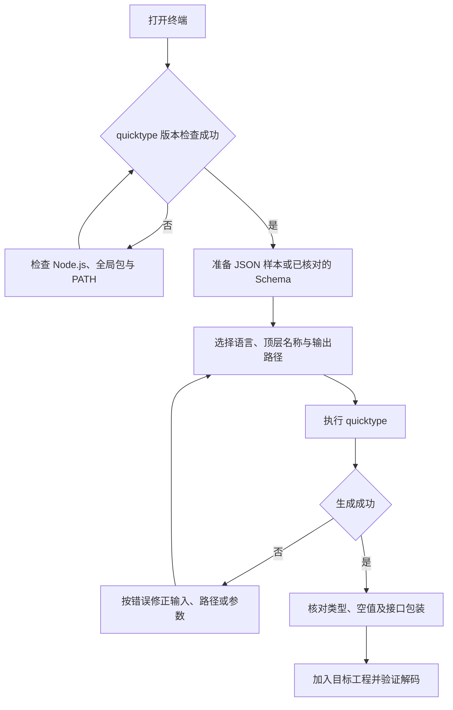

# `【MacOS】⚙️双击安装quicktype.command`


[toc]

---

## 🔥 <span id="前言">前言</span>

[**quicktype**](https://quicktype.io/) 根据 [**JSON**](https://www.json.org/json-en.html) 示例或类型描述生成模型代码与编解码辅助方法，适合把接口返回数据转换为工程中的数据模型。

**安装完成后，在终端运行 `quicktype` 命令即可生成模型，无需再次双击安装脚本。** 安装脚本负责准备工具链；模型生成命令负责读取输入并输出代码。

- [安装后快速开始](#quick-start)：检查命令、准备示例、生成第一个模型。
- [不同语言与生成选项](#languages)：模型生成、仅输出类型与工程接入。
- [输入方式与常用参数](#inputs)：文件、管道、剪贴板和接口地址。
- [类型推断与接口契约](#schema)：减少样本缺失导致的类型错误。
- [安装脚本行为与风险](#installer)：重新安装或升级前阅读。
- [常见问题与日志](#troubleshooting)、[流程与验证](#verification)。

## 一、<span id="quick-start">安装后快速开始</span> <a href="#前言" style="font-size:17px; color:green;"><b>🔼</b></a> <a href="#🔚" style="font-size:17px; color:green;"><b>🔽</b></a>

### 1.1、检查命令是否可用 <a href="#前言" style="font-size:17px; color:green;"><b>🔼</b></a> <a href="#🔚" style="font-size:17px; color:green;"><b>🔽</b></a>

安装结束后打开新的终端窗口，执行以下只读检查：

```shell
command -v quicktype
quicktype --version
quicktype --help
```

前两条命令应分别显示命令路径和版本号。参数与验证基线见[流程与验证](#verification)；找不到命令时先看[常见问题](#troubleshooting)。

### 1.2、准备一份示例数据 <a href="#前言" style="font-size:17px; color:green;"><b>🔼</b></a> <a href="#🔚" style="font-size:17px; color:green;"><b>🔽</b></a>

在终端进入本 `README.md` 所在目录。以下路径均相对于此目录；命令会创建 `./quicktype-demo/`，重复执行会覆盖其中的同名示例和生成文件，首次练习应使用空目录。

```shell
mkdir -p './quicktype-demo/generated'
cat > './quicktype-demo/user.json' <<'JSON'
{
  "id": 1001,
  "name": "Jobs",
  "is_vip": true,
  "tags": ["iOS", "工具"],
  "profile": {
    "city": "上海"
  }
}
JSON
```

实际使用时，把接口返回的完整数据保存为 `.json` 文件，再替换命令中的输入路径。存在 `code`、`message`、`data` 包装时，生成的顶层模型也会包含这些字段。

### 1.3、生成第一个 <u>[**Swift**](https://www.swift.org/)</u> 模型 <a href="#前言" style="font-size:17px; color:green;"><b>🔼</b></a> <a href="#🔚" style="font-size:17px; color:green;"><b>🔽</b></a>

```shell
quicktype './quicktype-demo/user.json' \
  --src-lang json \
  --lang swift \
  --top-level User \
  --out './quicktype-demo/generated/User.swift'
```

输入是 `./quicktype-demo/user.json`，输出是 `./quicktype-demo/generated/User.swift`，顶层模型名是 `User`；嵌套对象也会生成对应类型。`--out` 会覆盖同名文件，输出目录应提前创建。

省略 `--out` 时，代码直接输出到终端，适合先预览：

```shell
quicktype './quicktype-demo/user.json' \
  --lang swift \
  --top-level User
```

## 二、<span id="languages">不同语言与生成选项</span> <a href="#前言" style="font-size:17px; color:green;"><b>🔼</b></a> <a href="#🔚" style="font-size:17px; color:green;"><b>🔽</b></a>

以下命令复用[快速开始](#quick-start)的示例文件和输出目录。

### 2.1、Swift 模型接入工程 <a href="#前言" style="font-size:17px; color:green;"><b>🔼</b></a> <a href="#🔚" style="font-size:17px; color:green;"><b>🔽</b></a>

默认输出包含模型和编解码辅助代码。把 `User.swift` 加入 [**Xcode**](https://developer.apple.com/xcode) 工程并勾选目标 target 后，可以使用系统 [**JSONDecoder**](https://developer.apple.com/documentation/foundation/jsondecoder) 的 `decode(User.self, from: data)` 解码接口响应；`data` 是完整响应的字节数据，根节点结构须与生成时一致。

- 需要引用类型或可变属性时，显式设置选项：

  ```shell
  quicktype './quicktype-demo/user.json' \
    --lang swift \
    --top-level User \
    --struct-or-class class \
    --mutable-properties \
    --out './quicktype-demo/generated/UserClass.swift'
  ```

- 仅保留类型声明时，使用 `--just-types`：

  ```shell
  quicktype './quicktype-demo/user.json' \
    --lang swift \
    --top-level User \
    --just-types \
    --out './quicktype-demo/generated/UserTypes.swift'
  ```

  该选项会移除编解码支持，不能继续套用上面的解码调用。生成的 `User` 与完整版本同名，接入同一个 target 时二选一。

`User.swift`、`UserClass.swift`、`UserTypes.swift` 是对比用的不同生成方案，不应同时加入同一模块。正式接入 Jobs 工程前，按目标工程约定整理文件头、模型组织和访问权限；生成器不会自动套用 Jobs 的模型封装。

### 2.2、生成 [**Objective-C**](https://developer.apple.com/library/archive/documentation/Cocoa/Conceptual/ProgrammingWithObjectiveC/Introduction/Introduction.html) 模型 <a href="#前言" style="font-size:17px; color:green;"><b>🔼</b></a> <a href="#🔚" style="font-size:17px; color:green;"><b>🔽</b></a>

```shell
quicktype './quicktype-demo/user.json' \
  --lang objc \
  --top-level User \
  --class-prefix Jobs \
  --out './quicktype-demo/generated/User.m'
```

该命令输出配套的 `User.h` 和 `User.m`，`--class-prefix Jobs` 为生成的类名添加前缀。将两份文件一起加入目标工程，并确认 `.m` 参与编译。具体类名与转换方法以生成的头文件为准；此处输出参数应使用 `.m`，不要改成 `.h`。

### 2.3、生成 [**Dart**](https://dart.dev) 与 [**TypeScript**](https://www.typescriptlang.org/) 模型 <a href="#前言" style="font-size:17px; color:green;"><b>🔼</b></a> <a href="#🔚" style="font-size:17px; color:green;"><b>🔽</b></a>

- Dart 模型可用于 [**Flutter**](https://flutter.dev/) 工程，生成后放入项目既有模型目录：

  ```shell
  quicktype './quicktype-demo/user.json' \
    --lang dart \
    --top-level User \
    --out './quicktype-demo/generated/user.dart'
  ```

- TypeScript 默认包含类型和转换辅助代码；只需要类型接口时添加 `--just-types`：

  ```shell
  quicktype './quicktype-demo/user.json' \
    --lang typescript \
    --top-level User \
    --just-types \
    --out './quicktype-demo/generated/user.ts'
  ```

  仅类型输出不提供运行时数据校验。语言专属参数以本机 `quicktype --help` 的对应语言章节为准，不能把所有选项直接套到其它语言。

## 三、<span id="inputs">输入方式与常用参数</span> <a href="#前言" style="font-size:17px; color:green;"><b>🔼</b></a> <a href="#🔚" style="font-size:17px; color:green;"><b>🔽</b></a>

### 3.1、文件、管道与剪贴板 <a href="#前言" style="font-size:17px; color:green;"><b>🔼</b></a> <a href="#🔚" style="font-size:17px; color:green;"><b>🔽</b></a>

- 文件输入适合保存接口样本并重复生成，完整命令见[快速开始](#quick-start)。
- 管道输入适合临时数据；未提供文件参数时从标准输入读取：

  ```shell
  printf '%s\n' '{"id":1001,"name":"Jobs"}' | \
    quicktype \
      --lang swift \
      --top-level User
  ```

- 在 [**macOS**](https://www.apple.com/macos/) 中复制完整 JSON 后，可用系统剪贴板命令 `pbpaste` 直接生成：

  ```shell
  pbpaste | \
    quicktype \
      --lang swift \
      --top-level ClipboardUser \
      --out './quicktype-demo/generated/ClipboardUser.swift'
  ```

  剪贴板必须是合法 JSON；日志文字、代码围栏和接口地址不能作为 JSON 正文直接输入。

### 3.2、从接口地址读取 <a href="#前言" style="font-size:17px; color:green;"><b>🔼</b></a> <a href="#🔚" style="font-size:17px; color:green;"><b>🔽</b></a>

quicktype 可直接读取返回 JSON 的接口地址。例如，以下命令访问 [**GitHub**](https://github.com) 的公开仓库接口，需要联网：

```shell
quicktype 'https://api.github.com/repos/glideapps/quicktype' \
  --lang swift \
  --top-level Repository \
  --out './quicktype-demo/generated/Repository.swift'
```

遇到登录、分页、请求方法或接口限流时，先使用现有接口调试工具获取成功响应，保存为本地 JSON，再使用文件输入。生成模型只描述收到的数据，不会自动实现分页或登录流程。

### 3.3、常用参数速查 <a href="#前言" style="font-size:17px; color:green;"><b>🔼</b></a> <a href="#🔚" style="font-size:17px; color:green;"><b>🔽</b></a>

| 参数 | 用途 | 示例值 |
|---|---|---|
| `--lang` / `-l` | 输出语言 | `swift`、`objc`、`dart`、`typescript`、`schema` |
| `--src-lang` / `-s` | 输入类型，默认 `json` | `json`、`schema` |
| `--top-level` / `-t` | 顶层类型名 | `User`、`UserResponse` |
| `--out` / `-o` | 输出路径；省略时输出到终端 | `./quicktype-demo/generated/User.swift` |
| `--just-types` | 仅生成类型；含义随目标语言变化 | Swift 不再生成编解码支持 |
| `--all-properties-optional` | 把所有对象属性设为可选 | 接口确实允许缺字段时使用 |
| `--no-date-times` | 不把日期时间字符串推断成日期类型 | 保留原始字符串 |
| `--no-enums` | 不把字符串样本推断成枚举 | 接口取值开放时使用 |
| `--help` / `--version` | 查看帮助 / 版本 | 不生成文件 |

虽然输出文件后缀可以用于推断语言与名称，长期复用的命令仍建议显式指定 `--lang` 和 `--top-level`。

## 四、<span id="schema">类型推断与接口契约</span> <a href="#前言" style="font-size:17px; color:green;"><b>🔼</b></a> <a href="#🔚" style="font-size:17px; color:green;"><b>🔽</b></a>

### 4.1、先核对样本覆盖范围 <a href="#前言" style="font-size:17px; color:green;"><b>🔼</b></a> <a href="#🔚" style="font-size:17px; color:green;"><b>🔽</b></a>

quicktype 根据输入推断类型，单份成功响应不能代表接口的全部情况：

- 字段只出现 `null`、数组始终为空时，无法推断其真实业务类型，应补充有值样本或类型描述。
- 字段在样本中始终存在，不代表服务端永远返回；应同时核对缺字段、`null`、失败响应与空列表。
- 顶层数组对应数组数据，解码时也应使用数组类型；接口包装对象与内部 `data` 对象应分别命名和处理。
- 日期格式不固定时，可先用 `--no-date-times` 保留字符串，再由业务层统一处理。
- 新响应解码失败时，应检查实际字段及类型变化，再修正样本或契约并重新生成；不要直接覆盖已经手工维护的模型。

### 4.2、通过 [**JSON Schema**](https://json-schema.org/) 固定类型 <a href="#前言" style="font-size:17px; color:green;"><b>🔼</b></a> <a href="#🔚" style="font-size:17px; color:green;"><b>🔽</b></a>

需要多端共用模型时，可以先从样本推断 Schema，人工核对字段类型、`required` 和空值规则，再据此生成各语言代码：

```shell
quicktype './quicktype-demo/user.json' \
  --lang schema \
  --top-level User \
  --out './quicktype-demo/user.schema.json'
```

确认 `./quicktype-demo/user.schema.json` 内容后执行：

```shell
quicktype './quicktype-demo/user.schema.json' \
  --src-lang schema \
  --lang swift \
  --top-level User \
  --out './quicktype-demo/generated/UserFromSchema.swift'
```

输入为 Schema 时必须写 `--src-lang schema`，否则会把 Schema 本身当成普通 JSON 样本。`UserFromSchema.swift` 也定义 `User`，不能与前文的其它 `User` 版本同时加入一个模块。契约流程可参阅 [quicktype 官方使用说明](https://github.com/glideapps/quicktype#generating-code-from-json-schema)。

## 五、<span id="installer">安装脚本行为与风险</span> <a href="#前言" style="font-size:17px; color:green;"><b>🔼</b></a> <a href="#🔚" style="font-size:17px; color:green;"><b>🔽</b></a>

### 5.1、用途、依赖与运行方式 <a href="#前言" style="font-size:17px; color:green;"><b>🔼</b></a> <a href="#🔚" style="font-size:17px; color:green;"><b>🔽</b></a>

同目录的[安装脚本](./【MacOS】⚙️双击安装quicktype.command)用于安装或更新 [**Homebrew**](https://brew.sh/)、[**Node.js**](https://nodejs.org)、[**npm**](https://docs.npmjs.com/)、[**fzf**](https://formulae.brew.sh/formula/fzf) 和 quicktype。quicktype 通过 npm 全局安装；fzf 由该脚本一并维护，日常生成模型不需要使用选择器。

脚本由 [**zsh**](https://www.zsh.org/) 运行，支持双击 `.command`，也可在当前目录通过终端启动：

```shell
/bin/zsh './【MacOS】⚙️双击安装quicktype.command'
```

运行前确认网络可访问对应官方源；Homebrew 用户目录安装还需要可用的 [**Git**](https://git-scm.com/) 与 [**curl**](https://curl.se/)。现行 quicktype 官方要求 Node.js 20 或更高版本，版本要求参见[官方安装说明](https://github.com/glideapps/quicktype#installation)。安装脚本没有业务参数，输出模型的参数应传给 `quicktype` 命令。

### 5.2、实际交互与影响范围 <a href="#前言" style="font-size:17px; color:green;"><b>🔼</b></a> <a href="#🔚" style="font-size:17px; color:green;"><b>🔽</b></a>

**重新运行安装脚本会修改工具链，可能升级其它已安装的软件包；仅生成模型时直接使用前文命令。**

- 启动时打印脚本内置自述并等待回车，进入安装业务前还会显示安装说明并再次等待；这些内容写在脚本内部，并非运行时读取 `README.md`。按 `Ctrl+C` 可以取消。
- 缺少 Homebrew 时，精确输入大写 `YES` 选择系统标准目录；其它输入或直接回车选择当前用户的 `.local/homebrew` 目录。管理员权限由系统安装器处理，选定路径失败不会自动切换。
- 已有 Homebrew 时有一轮“回车跳过，输入任意字符执行”的维护询问；**其后的业务仍会直接运行 `brew update`、`brew upgrade`，以及 Node.js、fzf 的安装或升级**。跳过该询问不能跳过后续全部升级。
- quicktype 的安装或更新使用 `sudo npm install -g quicktype` 或 `sudo npm update -g quicktype`，可能要求管理员密码；选择 Homebrew 用户目录不代表后续 npm 步骤也免管理员权限。
- 脚本会写入当前用户 Shell 配置中的 Homebrew 环境块，记录日志，并修改全局 npm 包。部分升级失败仅打印警告，最终仍须通过 `quicktype --version` 和实际生成命令确认可用。

## 六、<span id="troubleshooting">常见问题与日志</span> <a href="#前言" style="font-size:17px; color:green;"><b>🔼</b></a> <a href="#🔚" style="font-size:17px; color:green;"><b>🔽</b></a>

| 现象 | 排查方法 |
|---|---|
| `command not found: quicktype` | 先打开新终端；执行下方检查，确认全局包存在且 npm 全局可执行目录已加入 `PATH`，同时确认 `node --version` 可用 |
| JSON 解析失败 | 去掉注释、尾逗号、代码围栏及日志前缀；确认文件实际是 JSON，未误存网页或登录页面 |
| 输出路径不存在 | 先创建输出父目录；中文、空格及特殊字符路径始终加引号 |
| 字段类型不符合业务 | 补充代表性样本，或按[接口契约](#schema)修正 Schema；不要只依赖一条成功响应 |
| 模型重复定义 | 检查同一 target 是否同时加入多个示例方案；同名模型只保留一个版本 |
| 参数不识别 | 检查本机版本及 `quicktype --help`，确认参数属于当前目标语言 |
| 显示安装结束但命令不可用 | 检查版本、npm 全局包和 PATH；结合日志与终端中的首个失败命令定位，不以结束提示代替验证 |

命令发现与全局包检查：

```shell
command -v node
node --version
command -v npm
npm --version
npm list -g quicktype --depth=0
npm prefix -g
command -v quicktype
```

macOS 下，npm 全局可执行目录通常是 `npm prefix -g` 输出目录内的 `bin/`；只检查实际使用的那套 Node.js / npm，避免混用多个工具链。

安装日志名为 `【MacOS】⚙️双击安装quicktype.log`，位于系统临时目录中，具体位置以安装脚本结束时打印的路径为准。每次启动会清空同名旧日志；彩色日志函数的输出会写入文件，部分外部命令的原始输出仍需在终端中查看。日常 `quicktype` 命令不会沿用安装日志，生成结果在 `--out` 指定的路径。

## 七、<span id="verification">流程与验证</span> <a href="#前言" style="font-size:17px; color:green;"><b>🔼</b></a> <a href="#🔚" style="font-size:17px; color:green;"><b>🔽</b></a>

以下 [**Mermaid**](https://mermaid.js.org) 图对应安装完成后的模型生成流程：



- 命令验证基线：2026-10-16，本机 `quicktype 24.0.2`。
- 目录、标题上下导航与 Mermaid 流程图已完成浏览器预览核对。
- 安装脚本通过 `zsh -n` 静态语法检查；文档维护未重新执行安装、升级或管理员命令。
- 生成示例在独立临时目录验证；接入业务工程后的编译与真实接口解码，应使用目标工程和实际响应另行验证。
- 更多语言及当前参数参见 [quicktype 官方仓库](https://github.com/glideapps/quicktype)；交互式试用入口为 [quicktype 在线编辑器](https://app.quicktype.io/)。

<a id="🔚" href="#前言" style="font-size:17px; color:green; font-weight:bold;">我是有底线的➤点我回到首页</a>
